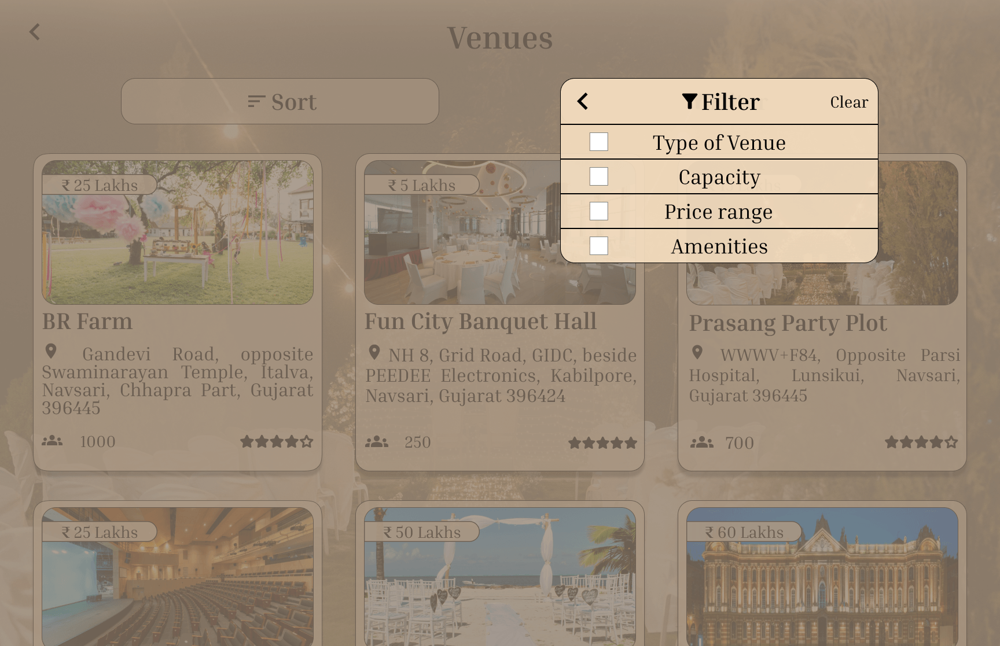
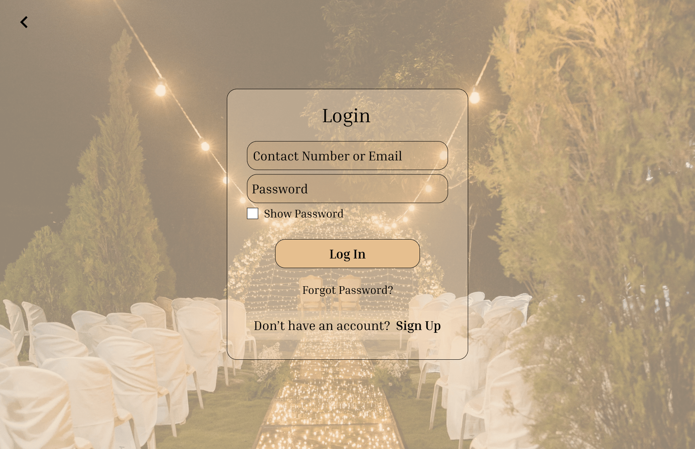
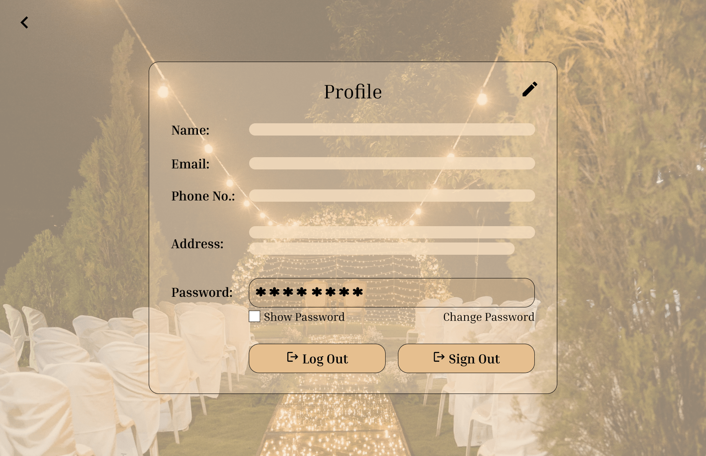
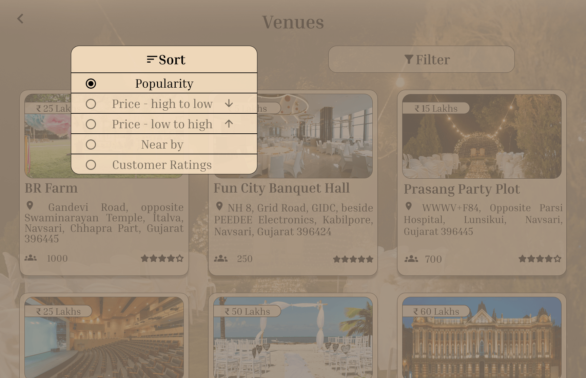
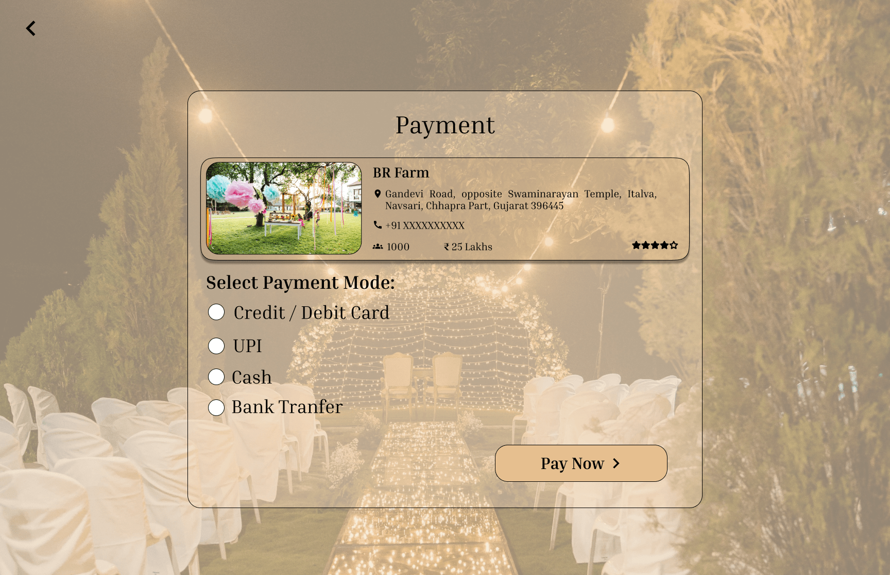
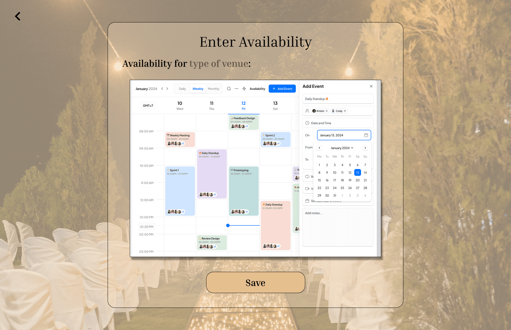

# ✨ Venue Vista

### Venue Booking Website · UI/UX Design Concept

## ✨ Project Overview

**Venue Vista** is a venue discovery and booking website concept designed to make it easier for users to explore venues, compare available options, and move through the booking journey with confidence. It also includes tools for venue owners and admins.

| | |
|---|---|
| 🎯 **Goal** | Create a user-friendly venue browsing experience with clear information, intuitive navigation, and a consistent visual interface |
| 👩‍🎨 **My Role** | UI/UX Designer |
| 🖥️ **Platform** | Desktop website (33 screens) |
| 🛠️ **Tools** | Figma · Wireframing · UI Design · Interactive Prototyping |
| 📌 **Status** | UI/UX design concept (design and prototype only, not a coded application) |

## 🌟 Design Highlights

  
  

  
  

- **Clear visual hierarchy** so important details stand out first
- **Organized venue information** that is easy to scan and compare
- **Consistent typography and spacing** across every page
- **Intuitive navigation** that keeps users oriented
- **User-focused booking flow** with minimal friction

## 🖼️ All Screens (33)

<b>🔐 Onboarding & Account</b> (6 screens)

 

  
  
  

  
  
  

<b>🏛️ Browse & Discover</b> (3 screens)

 

  
  
  

<b>🎛️ Sort & Filters</b> (6 screens)

 

  
  
  

  
  
  

<b>📋 Venue Details</b> (2 screens)

 

  
  

<b>📅 Booking Journey</b> (4 screens)

 

  
  
  

  

<b>ℹ️ Information Pages</b> (2 screens)

 

  
  

<b>🏢 Venue Owner</b> (6 screens)

 

  
  
  

  
  
  

<b>🛠️ Admin Dashboard</b> (4 screens)

 

  
  
  

  

## 🔑 Key Features

**For users**
- 🔐 Login with contact number or email, sign up, and a two-step forgot password flow
- 🔍 Venue browsing with sort and filters (type of venue, capacity, price range, amenities)
- 🏛️ Venue cards showing photo, price in ₹, location, capacity, and star rating
- 📋 Venue detail pages with a photo carousel, description, address, and contact details
- 📅 Booking flow: booking details, a summary with a venue recap, and payment
- 🗂️ "My Bookings", event gallery, about us, and contact pages

**For venue owners**
- 📝 Forms to enter venue details (contact info, hours, photo upload, overview)
- 📆 Availability entry for their venue
- 👀 "All Booking Details" view of current bookings

**For admins**
- 🛠️ Dashboard with a sidebar for managing venues, users, and activities

## 📖 Case Study

### 🧩 The Challenge

Finding and booking an event venue usually means jumping between listings, comparing details by hand, and chasing availability. Venue Vista explores how one platform can take someone from browsing venues such as farms, banquet halls, and party plots to a confirmed booking, while giving venue owners and admins the tools to manage what sits behind it.

### 🎯 Goals

- Make venues **easy to find and compare** with sorting, filters, and clear venue cards
- Give users **everything they need to decide**: photos, price, capacity, location, and contact details
- Keep the **booking and payment flow short and clear**
- Give venue owners and admins **simple tools** to manage listings, bookings, and users

### 👥 Users

| Role | What they can do |
|---|---|
| **Users** | Browse and filter venues, view details, book and pay, review their bookings |
| **Venue owners** | Add venue details and photos, set availability, see all bookings |
| **Admins** | Manage venues, users, and platform activities |

### 🛠️ Process

| Phase | What I did |
|---|---|
| **Wireframing** | Mapped the flow and layout of the main pages |
| **UI Design** | Designed 33 desktop screens in Figma with a consistent look |
| **Prototyping** | Linked the screens into an interactive prototype |

### 🗺️ User Flows

### 💡 Key Design Decisions

- **One atmosphere across every screen.** A full-bleed night-venue photo sits behind translucent cream panels, so the product feels like an event experience and all 33 screens stay consistent.
- **Three entry points on the splash screen** (Admin, Venue, and User Login), so each role gets its own path from the very first screen.
- **Venue cards carry the key comparison details** (photo, price pill, name, address, capacity, star rating), so users can scan and compare without opening every venue.
- **Filtering lives in one compact panel** with four categories and a Clear option, kept separate from sorting.
- **The booking summary repeats the venue card** above the booking fields, so users confirm exactly what they're booking before they pay.
- **Venue owners get plain form screens** for details, photos, and availability, with a separate view of all current bookings.
- **Admins get a sidebar** with Venues, Users, and Activities, plus profile and log out.
- **Every inner screen has a back arrow**, and login includes a show-password option and a forgot-password link.

### 🎨 Design System

| Element | Details |
|---|---|
| **Primary action colour** | `#E6BF8F` (warm sand), used for the Log In, Pay, Save, and Upload buttons |
| **Panel colour** | Soft cream, about `#F0D9BB`, used for price pills, filter panel, and form fields |
| **Text** | Near-black for headings and labels |
| **Background** | Night venue photograph with warm translucent overlays |
| **Typography** | Elegant serif for headings, labels, and body text, with an italic script-style serif for the Venue Vista logo and tagline |
| **Shape and layout** | Rounded corners, pill buttons, and centred cards on a 1728 × 1117 desktop canvas |

**Components used across the screens**

- Top navigation bar with text links (Venues, Event Gallery, Contact Us, About Us) and an account menu
- Venue cards with price pill, capacity icon, and star rating
- Filter panel with checkboxes, plus a sort control
- Photo carousel on venue pages
- Translucent form cards, such as login, booking, and venue details
- Pill buttons for primary actions
- Admin sidebar navigation
- Calendar view for availability

### 🧠 Key Learnings

- **Three roles mean three journeys.** Designing for users, venue owners, and admins taught me to separate flows and navigation from the very first screen.
- **A consistent atmosphere holds a large set together.** One backdrop, one cream panel style, and one button style kept 33 screens coherent.
- **Text over photography needs care.** Translucent panels and dark serif text help, and contrast has to be checked on every screen.
- **Form-heavy screens need clear grouping.** Booking, venue details, and admin views work best when labels and fields are organized and easy to scan.

### 🔭 What's Next

- Usability testing of the booking flow with real users
- Accessibility review, especially text contrast on translucent panels
- Mobile and responsive versions of the key screens
- Building the front end in code

## 🚀 Interactive Prototype

Explore the full clickable prototype in Figma:

## 👩‍💻 About the Designer

**Dhruvi Bodalia**: UI/UX Designer · Front-End Developer · Master's student in Applied Computing at Wilfrid Laurier University

⭐ Thanks for visiting! Feedback on the design is always welcome.

